<!-- ELAIZA | SAGE GARDEN -->

  

<h3 align="center">🌱 Hello, world! I'm Elaiza.</h3>

  <i>Growing, learning, and creating one line of code at a time.</i>

  
  

---

## 🍃 About Me

I'm a Computer Science student interested in technology, problem-solving, and building meaningful projects.

- 🎓 Computer Science Student
- 🧠 Exploring Artificial Intelligence and Machine Learning
- ☁️ Interested in Cloud Computing
- 💻 Learning through hands-on projects
- 🌻 Always curious about how things work

  

## 🪴 Tech Stack

  
  
  
  
  

## 🌷 My Projects

| Project | Description |
|---|---|
| 🌿 [Hulma](https://github.com/Aiza-C/hulma) | Body-type fashion recommender |
| 🍀 [Talas](https://github.com/Aiza-C/talas) | Relevant online shopping review filter |
| 🧟 [WRATE](https://github.com/Aiza-C/WRATE) | Zombie apocalypse interactive novel |
| 🥀 [Kawangis](https://github.com/Aiza-C/kawangis) | Psychological romantic-horror visual novel |
| 🌱 [CSyllabus](https://github.com/Aiza-C/csyllabus) | BSCS curriculum tracker |

  

## 🌳 GitHub Garden

  
  

  

---

## 🐍 My Contribution Garden

  <picture>
    <source
      media="(prefers-color-scheme: dark)"
      srcset="https://raw.githubusercontent.com/Aiza-C/Aiza-C/output/github-snake-dark.svg"
    />
    <source
      media="(prefers-color-scheme: light)"
      srcset="https://raw.githubusercontent.com/Aiza-C/Aiza-C/output/github-snake.svg"
    />
    
  </picture>

  

## 🐸 Currently Growing

- 🌱 Improving my programming skills
- 🧠 Exploring AI and Machine Learning
- 🛠️ Building personal and academic projects
- ☁️ Learning about cloud technologies

---

  <i>"Everything grows at its own pace."</i>
   
  🌿 🐸 🍄 🌱
   
  Thanks for visiting my little corner of GitHub!

  

